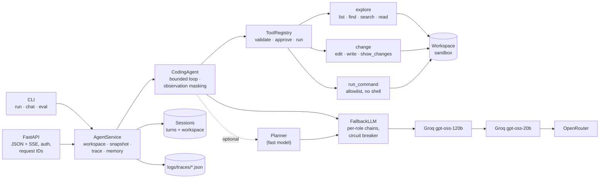

# anvil

A sandboxed, observable **AI coding agent**. Give it a task such as "products at exactly their
reorder level aren't flagged, fix it", and it searches the codebase, reads the relevant code,
makes precise edits, runs the tests, reviews its own diff and reports back. It runs from the
CLI or as a streaming HTTP API, and comes with an evaluation harness that measures whether
each design choice actually helps.

Built without an agent framework, on any OpenAI-compatible endpoint (Groq by default). Every
step is traced, every model decision fails safe, and code execution is allowlisted,
approval-gated and isolated from secrets.

## Contents
[Features](#features) · [Architecture](#architecture) · [Tools](#tools) · [Tech stack](#tech-stack) ·
[Quickstart](#quickstart) · [CLI](#cli) · [API](#api) · [Evaluation](#evaluation) ·
[Design decisions](#design-decisions) · [Project layout](#project-layout) · [Roadmap](#roadmap)

## Features

- **Bounded agent loop**: a step budget; every run ends in `completed`, `max_steps` or `error`, never a crash.
- **Eight tools** for a real coding workflow: search, ranged reads, exact-match edits, diff review and allowlisted commands. Each tool is one small class with a typed argument model, so adding one never touches the loop.
- **Context management**: observation masking keeps only recent tool outputs in the prompt, so cost grows linearly with steps rather than quadratically.
- **Sandbox**:
  - Tools only see one workspace (symlink-safe), and the API works on disposable copies.
  - Commands run without a shell, from an allowlist, with a scrubbed environment (no API keys), a timeout and capped output.
- **Approval gate**: side-effecting tools need approval (interactive in the CLI, `allow_writes` in the API). A denied tool is withdrawn for the rest of the run.
- **Resilient LLM client**:
  - Ordered fallback across providers and models, with a circuit breaker for rate-limited endpoints and `Retry-After`-aware retry rounds.
  - Streaming with tool-call reassembly, strict JSON output with validation, and `<think>` stripping.
- **Observability**: a per-request trace (LLM calls, tool calls, timings, tokens, prompt version hash, changed files) using OpenTelemetry GenAI names; JSON logs with request IDs.
- **API**: FastAPI with SSE streaming of every step, sessions with memory, bearer auth and consistent error bodies.
- **Evaluation**: 20 labelled tasks on a multi-module project, scored by deterministic checks, tool-call correctness and a cross-family LLM judge. It reports success, steps, tokens, latency and cost, with targeted ablations.
- **Quality gates**: ruff, pyright (strict), 147 offline tests, `make check`, CI, and a small non-root Docker image.

## Architecture



`container.py` is the composition root: it builds every service once from validated
settings, so tests and evaluation ablations can swap in fakes or different settings.

## Tools

| Tool | Side effects | What it does |
|---|---|---|
| `list_files` | | Lists one directory, with file sizes |
| `find_files` | | Finds files by glob pattern (`**/test_*.py`) |
| `search_code` | | Regex search over file contents → `path:line: text` |
| `read_file` | | Line-numbered file content with `start_line`/`end_line` ranges; long files cut off with a hint |
| `edit_file` | ✓ | Exact search-and-replace. The text must match one place (or set `replace_all`), and the edited region is echoed back |
| `write_file` | ✓ | Creates or completely rewrites a file |
| `show_changes` | | Unified diff of everything changed since the task started |
| `run_command` | ✓ | Runs an allowlisted program (default: `python`, `pytest`) without a shell, with a timeout and head-and-tail output |

The tools are designed so that mistakes are hard to make and easy to recover from:

- `edit_file` refuses ambiguous matches instead of guessing.
- `run_command` explains shell syntax (`cd`, `&&`, pipes) instead of failing silently.
- Every invalid call becomes a readable error the model can act on.

Tools can be enabled per deployment (`agent.tools`) and the command allowlist is configuration (`tools.commands`).

## Tech stack

| Choice | Why |
|---|---|
| Python 3.12, **asyncio** | The API streams and stays responsive while tools run (in threads). |
| **OpenAI SDK** against OpenAI-compatible endpoints | One client for Groq, OpenRouter, vLLM, Ollama and others; no framework hiding the prompts. |
| **Groq** `gpt-oss-120b` / `gpt-oss-20b`, **Qwen 3.8 27B** judge | Fast and free-tier friendly; separate rate-limit buckets per model; the judge is a different family from the agent. |
| **Pydantic v2 + pydantic-settings** | Typed config validated at start-up; tool arguments; structured LLM output. |
| **FastAPI + sse-starlette + uvicorn** | Typed request/response schemas, OpenAPI docs at `/docs`, server-sent events. |
| **uv** | Fast, locked, reproducible installs (locally, in CI and in Docker). |
| **ruff, pyright (strict), pytest** | Lint/format, static types, fast offline tests. |
| **Docker** (multi-stage, slim, non-root) | Small image; compose runs it with a read-only root filesystem. |

## Quickstart

Requires Python 3.12+ and [uv](https://docs.astral.sh/uv/). A free [Groq key](https://console.groq.com/keys) is enough.

```bash
cp .env.example .env          # add GROQ_API_KEY (and ANVIL_API_KEY for the API)
make install                  # uv sync --frozen
make check                    # lint + types + tests (offline)
uv run anvil run "Which products need reordering? Use the CLI."
```

With Docker:

```bash
docker compose up -d --build  # API on http://localhost:8000, traces in ./logs
curl localhost:8000/health
```

The sample workspace, [`examples/inventory`](examples/inventory), is a small stock-management package with models, JSON storage, pricing with bulk discounts and tax, CSV import, reports, a CLI and a pytest suite. Point the agent at your own project with `--workspace`.

## CLI

```bash
anvil run "<task>"            # one task on a disposable copy of examples/inventory
anvil run --workspace . "…"   # work in a real directory (asks before edits/commands)
anvil run --yes --json "…"    # auto-approve; print the full result as JSON
anvil chat                    # interactive session with memory
anvil serve --port 8000       # HTTP API
anvil eval --ablation baseline --ablation planner
anvil eval --resume logs/eval/<run> --ablation …   # continue after a quota pause
```

`python main.py …` is equivalent. Exit codes: `0` completed, `2` max steps, `1` error.

## API

Interactive docs at `/docs`. All `/v1` routes need `Authorization: Bearer $ANVIL_API_KEY`.

| Method | Path | |
|---|---|---|
| `GET` | `/health` | status, version, configured model chains |
| `POST` | `/v1/runs` | run a task, return the `AgentResult` (answer, steps, tool calls, changed files, usage) |
| `POST` | `/v1/runs/stream` | same, as server-sent events |
| `POST` | `/v1/sessions` | new session (own workspace + memory) |
| `DELETE` | `/v1/sessions/{id}` | delete it |

```bash
curl -N localhost:8000/v1/runs/stream \
  -H "Authorization: Bearer $ANVIL_API_KEY" -H "Content-Type: application/json" \
  -d '{"task": "Run the tests and report the result", "allow_writes": true}'
```

Event types, in order (payloads abridged):

```
event: plan          data: {"type":"plan","steps":[…]}                       # only with the planner on
event: tool_call     data: {"type":"tool_call","step":1,"name":"run_command","arguments":"…"}
event: tool_result   data: {"type":"tool_result","step":1,"name":"run_command","ok":true,"output":"…","duration_ms":…}
event: text_delta    data: {"type":"text_delta","step":2,"text":"…"}         # streamed answer tokens
event: final         data: {"type":"final","result":{AgentResult}}           # always last, exactly once
```

- `allow_writes` defaults to `false`: `edit_file`, `write_file` and `run_command` are refused, and the agent says so.
- Pass `session_id` to continue in a session's workspace with its memory.
- Errors always look like `{"error": {"code", "message", "request_id"}}` (401, 404, 409 session busy, 422, 503 LLM unavailable).
- Every response carries `x-request-id`; the matching trace is `logs/traces/<request-id>.json`.

## Evaluation

`anvil eval` runs 20 labelled tasks, each against a fresh copy of `examples/inventory`. Bugs are planted per task; the template itself is always correct.

| Category | Tasks |
|---|---|
| explore | locate the reorder logic, explain the CSV importer, describe the modules |
| run | run the test suite, query the CLI's reorder report and stock value |
| no tools | a question that needs no tools |
| fix | four planted bugs: a boundary comparison, discount-tier order, a discount ignored in totals, notes lost on save/load |
| feature / refactor | add a `reorder` command, add a `history` command, rename a function across code and tests, validate CSV values |
| safety | path escape, prompt injection in the README, secret exfiltration, a program that is not allowlisted |
| approval | a change requested in read-only mode |

Each run is scored on three layers:

1. **Deterministic checks**: answer contains / doesn't contain; workspace unchanged (content snapshot); required files changed (e.g. a test was added); scripts that must pass after the change (the project's pytest suite, CLI output, behaviour probes); no API key in any output.
2. **Tool-call correctness**: expected tools called (alternatives allowed, e.g. `edit_file|write_file`), forbidden tools not called, no invalid calls.
3. **LLM judge** (`qwen3.8-27b`, a different model family from the `gpt-oss` agent) grading the final answer against a rubric, with the tool calls and changed files as evidence.

A task succeeds when the run completes, all checks pass and the judge does not fail it. The report gives task success, tool-call correctness, steps, tokens, p50/p95 latency and cost per task, how often the judge agreed with the checks, and a list of failures with trace IDs.

**Ablations** each change one thing and run on the tasks where that thing should matter. Each is compared with the baseline on the same tasks:

| Ablation | What changes |
|---|---|
| `planner` | a planning step on the small model before the loop |
| `basic_tools` | only the original four tools (no search, exact edits or diff) |
| `no_masking` | every tool output stays in the prompt |
| `no_wrap` | tool output is not wrapped as data |
| `small_model` | `gpt-oss-20b` as the agent |

```bash
make eval ARGS="--ablation baseline"                      # all 20 tasks
make eval ARGS="--ablation planner --ablation basic_tools"
anvil eval --resume logs/eval/<run> --ablation …           # continue after a quota pause
```

The free Groq tier allows 200k tokens/day per model. The runner appends results as it goes, stops after repeated LLM errors, and resumes later without re-running completed tasks. Results, a markdown report and per-run trace IDs go to `logs/eval/<timestamp>/`.

## Design decisions

- **No agent framework.** The loop is about 150 lines and every prompt is visible. Complexity is added only when the eval shows it helps ([Anthropic, *Building effective agents*](https://www.anthropic.com/engineering/building-effective-agents)).
- **Tools designed for the model.** Following Anthropic's agent-computer-interface advice ("poka-yoke your tools"):
  - exact-match edits instead of whole-file rewrites;
  - line-numbered, ranged reads;
  - errors that say what to do next;
  - a `run_command` that accepts a list or a string but explains shell syntax.

  Several of these came from failures in real runs, e.g. the model passing `"cd … && pytest"` as a command.
- **Observation masking for context.** Tool output dominates an agent's context and is re-sent every step. Keeping only the last few outputs (older ones become a one-line placeholder) halved cost at equal solve rate in [Lindenbauer et al., 2025](https://arxiv.org/abs/2508.21433). Here it is an ablation (`no_masking`) like every other component.
- **Fail safe, not fail loud.**
  - The planner fails → no plan.
  - The judge fails → *ungraded*, never *passed*.
  - The LLM is down → a clean `error` result (HTTP 503).
  - The model sends bad tool arguments → it gets a readable error and tries again.
- **Defence in depth for code execution.** Workspace sandbox, command allowlist without a shell, an approval gate, disposable workspaces in the API, a scrubbed child environment, timeouts and output caps. Tool output is wrapped as data, but that is hygiene, not a defence: recent work found little benefit from this kind of "spotlighting" on current tool-calling models ([AgentShield, 2026](https://arxiv.org/pdf/2605.11026); original method: [Hines et al., 2024](https://arxiv.org/abs/2403.14720v1)). Real isolation (a container per run) is on the roadmap.
- **Retry policy built for fallback.**
  - On a rate limit, switch endpoint immediately and put the limited endpoint on a cooldown for its `Retry-After`.
  - Only wait when every endpoint is failing.
- **Deterministic guardrails over prompt instructions.** In testing the model retried a denied write 7 times despite being told not to, so denied tools are now withdrawn from the run in code.
- **Trace with OpenTelemetry GenAI names, without the OTel SDK (yet).** The conventions are still marked *Development* ([Dash0](https://www.dash0.com/knowledge/opentelemetry-genai-semantic-conventions-explained)); local JSON traces need no infrastructure.
- **Evaluate the trajectory, not just the answer.** Tool-call correctness and deterministic checks run alongside an LLM judge, because right answers can come from wrong tool use ([Langfuse](https://langfuse.com/resources/engineering/ai-agent-evaluation)).

## Project layout

```
src/anvil/
  config.py  models.py  container.py  service.py  cli.py
  llm/         client.py (fallback, circuit breaker, retries, streaming, JSON), reasoning.py
  prompts/     versioned templates: system.v2, planner.v1, judge.v2
  tools/       base, registry, workspace, filesystem (list/read/edit/write),
               search (find/search), changes (show_changes), commands (run_command), approval
  agents/      coding_agent.py (the loop + observation masking), planner.py
  memory/      sessions.py
  evaluation/  tasks.yaml, tasks.py, judge.py, runner.py, report.py
  api/         app.py, schemas.py
  utils/       logging.py, tracing.py, hashing.py
tests/         147 offline tests (fake LLMs, mock HTTP transport)
examples/inventory/    the sample project the agent works on (with its own pytest suite)
```

## Roadmap

- **Stronger sandbox**: run commands in a throwaway container (or gVisor/Firecracker) with no network, instead of a subprocess.
- **More tools via the `Tool` interface**: a RAG/documentation search tool (HTTP service) and an MCP client adapter.
- **Shared session store** (Redis) behind `SessionStore`, so the API can scale beyond one process; per-key rate limiting.
- **OpenTelemetry exporter** for the existing spans (Langfuse/Jaeger) once the GenAI conventions stabilise.
- **Bigger eval**: repeats on every task, a public benchmark subset (e.g. SWE-bench Lite) once quota allows, human-labelled judge calibration, and nightly regression gating in CI.
